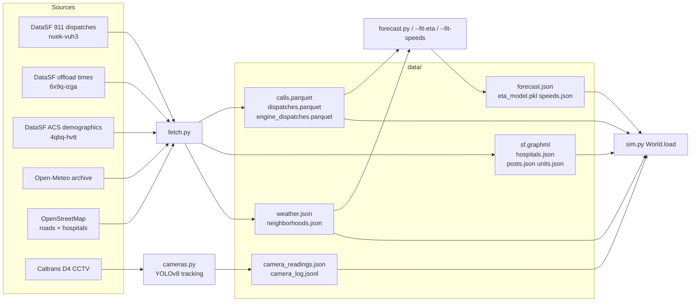
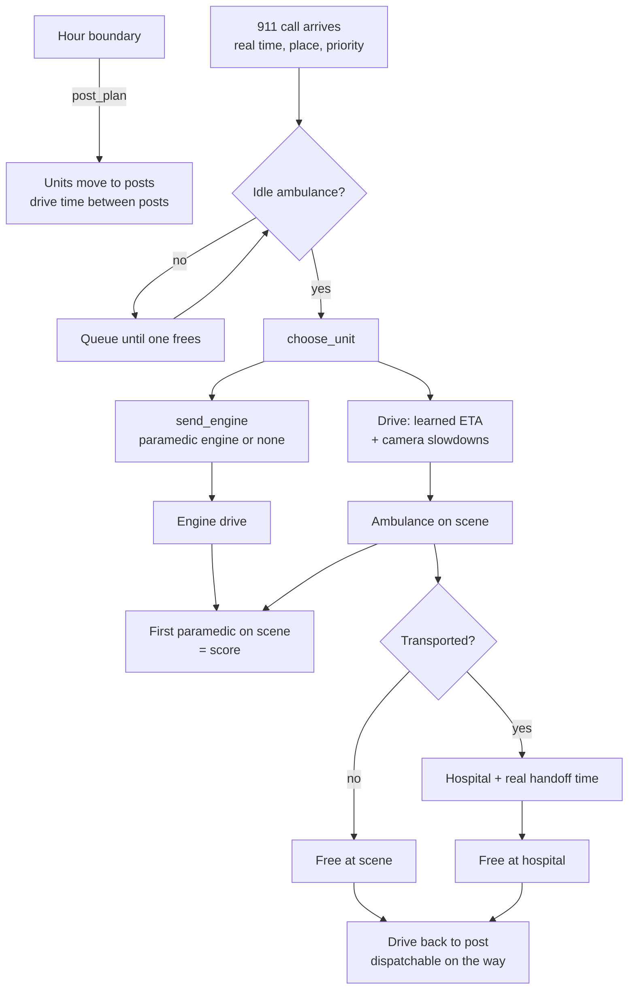
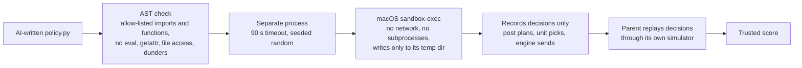
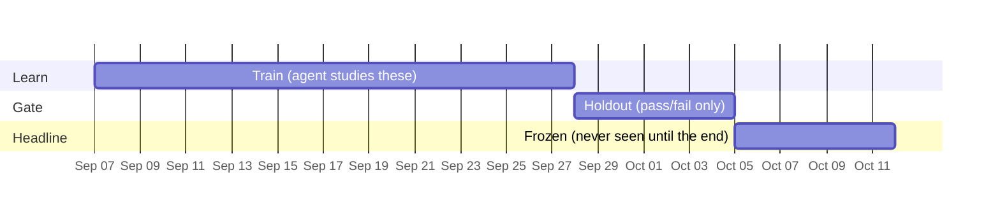
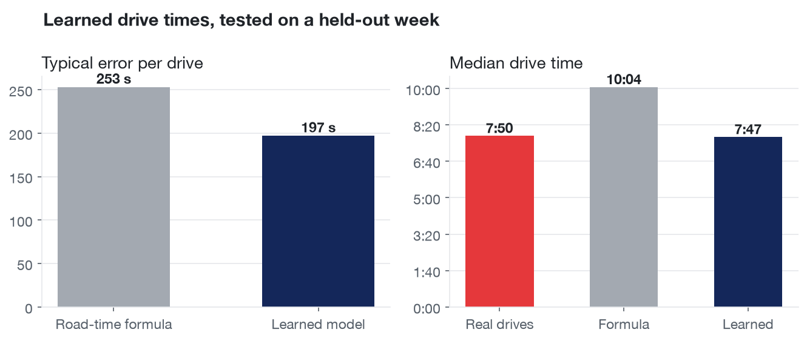
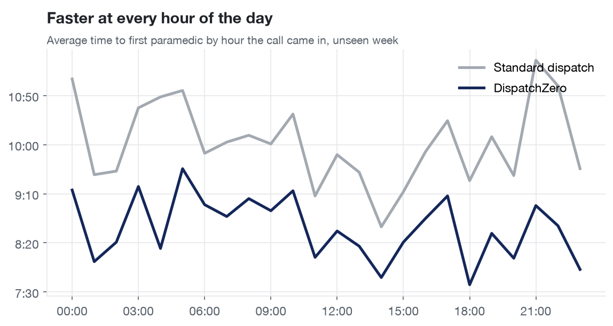
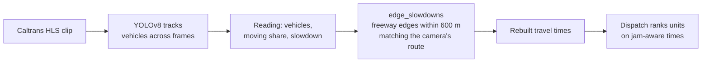
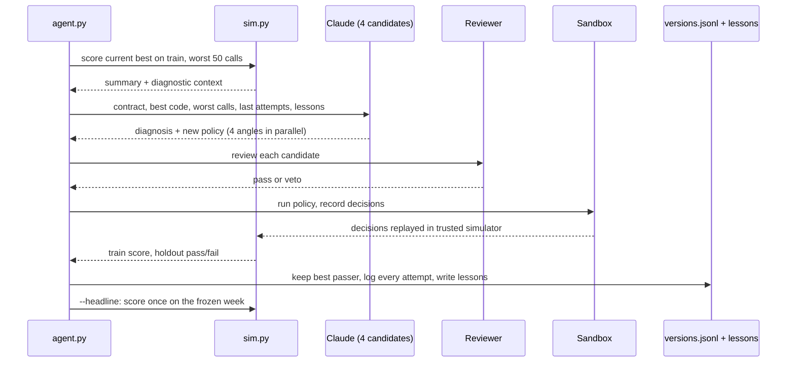
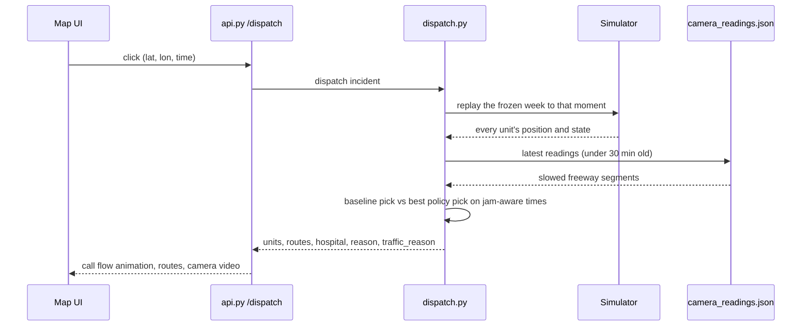

# DispatchZero: architecture

DispatchZero is a closed loop for emergency response. It senses San Francisco through public 911 records, the road network and live freeway cameras, keeps a calibrated digital twin of every ambulance and paramedic engine, lets an AI write and prove better dispatch rules, and serves those rules to a live dispatch API that explains every decision.

## Contents

- [System overview](#system-overview)
- [Data sources](#data-sources)
- [Layout](#layout)
- [Policy contract](#policy-contract)
- [Simulator](#simulator)
- [Policy sandbox](#policy-sandbox)
- [Baseline and goal](#baseline)
- [Splits and reporting](#splits-and-reporting)
- [Calibration](#calibration)
- [Learned road speeds](#learned-road-speeds)
- [Learned drive times](#learned-drive-times)
- [Paramedic engines](#paramedic-engines)
- [Cameras in the simulator](#cameras-in-the-simulator)
- [Agent loop](#agent-loop)
- [Demand forecast](#demand-forecast)
- [Live dispatch](#live-dispatch)
- [What-if experiments](#what-if-experiments)
- [Incident layers](#incident-layers)
- [API](#api)

## System overview



## Data sources

| Source | Provider / dataset | What we use | Volume |
|---|---|---|---|
| Fire Department Calls for Service | DataSF `nuek-vuh3` | Every ambulance and engine dispatch: received, dispatch, en route, on scene, available, location, priority, call type | 8,607 ambulance calls, 10,668 ambulance dispatches, 9,998 paramedic-engine dispatches over 5 weeks |
| Ambulance patient offload times | DataSF `6x9q-izga` | Hospital handoff time per hospital | 11 hospitals |
| Neighborhood demographics (ACS 2019 to 2023) | DataSF `4qbq-hvtt` | Population and share aged 65+ | 41 neighborhoods |
| Drive network | OpenStreetMap via `osmnx` | Road graph with speed limits and freeway refs | 10,033 intersections |
| Hospitals | OpenStreetMap | Emergency hospitals where transports end | 11 used |
| Weather | Open-Meteo archive | Hourly rain and temperature | 840 hours |
| Traffic cameras | Caltrans District 4 CCTV | Live HLS video and snapshots, YOLO vehicle counts and motion | 33 SF cameras |
| Learned drive-time model | Derived from `nuek-vuh3` | Gradient boosting on real ambulance drives | 5,165 drives |
| Demand forecast | Derived (Poisson regression) | Expected calls per neighborhood and hour | 34,440 neighborhood-hours |
| SFPD dispatched calls | DataSF `2zdj-bwza` (closed) and `gnap-fj3t` (real time) | Urgent police calls on the map and as dispatch warnings | 2,813 in the frozen week |
| SFPD incident reports | DataSF `wg3w-h783` | Last 90 days per 150 m cell, for the heatmap | 16,224 reports |
| Traffic crashes with injury | DataSF `ubvf-ztfx` | Crash heatmap | 16,689 since 2021 |
| CHP incidents | CHP media feed, Golden Gate center | Live freeway incidents in SF | live |

## Layout

| Path | What |
|---|---|
| `backend/contracts.py` | Frozen shapes: `Call`, `IdleUnit`, `CallResult`, `Summary`, `Version`, `CameraReading`, policy signatures |
| `backend/fetch.py` | Downloads every source above into `data/` |
| `backend/sim.py` | The digital twin: `replay(calls, policy, slowdowns, version, split) -> (results, summary)`, plus calibration and model fitting |
| `backend/policies/` | `baseline.py`, hand-written references and every AI-written version (`e001.py` onward) |
| `backend/agent.py` | Self-improvement loop: `--iters N [--candidates K] [--engines] [--traffic]`, `--headline` |
| `backend/forecast.py` | Poisson demand forecast per neighborhood and hour |
| `backend/daily.py` | Daily loop: fetch, calibrate if needed, re-score, learn, publish |
| `backend/cameras.py` | Caltrans HLS video → YOLOv8 tracking → `CameraReading` |
| `backend/dispatch.py` | Live dispatch of one incident, baseline vs best policy, with nearby police and CHP incidents as `warnings` |
| `backend/incidents.py` | SFPD calls, SFPD incident reports, CHP incidents and injury crashes for the map (see Incident layers): `--loop` live, `--history`, `--reports`, `--crashes` |
| `backend/api.py` | FastAPI: `uvicorn --app-dir backend api:app --port 8000` |
| `fixtures/` | Contract-shaped snapshots the UI can run on without the API |
| `frontend/` | Vite + React + MapLibre + deck.gl |
| `frontend/src/CityMap.jsx` | Replay map: neighborhoods, posts, calls as columns sized by response time, units en route, dispatch routes, 2D/3D view |
| `frontend/src/CameraCard.jsx` | Live Caltrans video (hls.js) with the camera's reading and the dispatch it changed |
| `frontend/src/CallFlow.jsx` | Step-by-step call flow for replay and live dispatch |
| `frontend/src/VersionLog.jsx` | Learning timeline: every rule tried, kept or rejected, and the lessons learned |
| `frontend/src/DispatchPanel.jsx` | Click-to-dispatch panel: baseline vs DispatchZero, reason, traffic reason, hospital |

`sim.py` CLI:

| Flag | Does |
|---|---|
| `--policy NAME_OR_PATH --split train\|holdout\|fit\|frozen [--compare baseline] [--out FILE]` | Score a policy |
| `--engines` | Add paramedic engines; score is first paramedic on scene |
| `--calibrate`, `--fit-speeds`, `--fit-eta` | Fit the twin to SF's real times |
| `--worst N` | Diagnostic context for the agent |
| `--jam-test CAMERA_ID [--slowdown F]`, `--traffic [PROFILE_JSON]`, `--traffic-report` | Camera experiments |
| `--offload-cap MINUTES`, `--dispatch-at-entry` | What-if experiments |
| `--self-check`, `--fixtures` | Assertions and UI snapshots |

## Policy contract

A policy is a Python file in `backend/policies/` with two functions:

```python
def post_plan(hour: int, units: list[str]) -> dict[str, int]
def choose_unit(call: Call, idle: list[IdleUnit], eta) -> str
```

`post_plan` is called at every hour boundary with the units on shift at that moment; units it leaves out keep their current post. `eta(unit, call)` returns drive seconds from the unit's current position to the call.

Injected globals:
- `HOME`: unit to home post (the baseline layout, see below)
- `POSTS`: list of `{post, station_area, lat, lon}`
- `DEMAND`: `{bucket: {post: calls}}` from the training weeks, each call counted at its nearest post
- `POST_DRIVE`: road drive seconds between posts, `POST_DRIVE[from][to]`
- `BUCKET_OF`: hour to time bucket (`night`, `morning_rush`, `midday`, `evening_rush`, `evening`)
- `WEATHER`: `"2026-09-07T14"` (call `t[:13]`) to `{rain_mm, temp_c}`, hourly from the Open-Meteo archive
- `NBHD`: neighborhood to `{population, pct_65_plus}`, ACS 2019 to 2023 via DataSF `4qbq-hvtt`
- `FORECAST`: `"Neighborhood|2026-09-07T14"` to expected calls that hour (`backend/forecast.py`, fit on the training weeks only), empty until `data/forecast.json` exists
- `TRAFFIC`: with `sim.py --traffic` only, otherwise `{}`. Time bucket to the freeway cameras slowed in it, `[{camera_id, name, route, lat, lon, slowdown, n}]`: the median of at least 3 logged camera readings in that bucket. `eta` and the simulator's dispatch, return, move and engine drive times already include it.
- `COVERAGE(units, call)`: lookahead. Expected seconds to reach this hour's forecast calls (FORECAST-weighted over neighborhoods) if only `units` (dicts with `post`) stay free. Compare `COVERAGE(idle, call)` with `COVERAGE(idle minus a candidate, call)` to see what sending that unit costs the next caller.

Rules the simulator enforces:
- Policies only see dispatcher-visible call fields: an opaque per-run `call_id`, `t`, `lat`, `lon`, `hour`, `nbhd`, `station_area`, `priority`, `life_threatening` (call type group is Potentially Life-Threatening, 62% of calls).
- Source is checked before loading: imports limited to `math`, `statistics`, `collections`, `itertools`, `functools`, `heapq`, `bisect`, `random`, and a module may only be used as `module.function` from a fixed export list (no `statistics.sys`, no submodules, no passing modules around). No attribute assignment, no reassigning anything imported, no `class` definitions, no names starting with `__`, no file access, `eval`/`exec`, `getattr`, `str.format` (use f-strings), underscore attributes, or frame attributes like `gi_frame`. Violations raise `PolicyRejected`.
- Every policy except `policies/baseline.py` runs in a separate process with a 90 s timeout. On macOS it is wrapped in `sandbox-exec`: no network, no starting other programs, writes only to its own temp dir, and file contents readable only from Python, `backend/` and `data/`. Without `sandbox-exec` it refuses to run unless `GM_UNSANDBOXED=1` is set. That process only records the policy's decisions (each hour's plan, each `choose_unit` and `send_engine` answer). The parent never imports the policy: it replays those decisions through its own `simulate`, so every result, stat, `--worst` row and `goal` comes from simulator code. `random` is seeded before the policy loads and at the start of every simulation, so runs are repeatable.
- `choose_unit` must return an idle unit's id. Anything else, or an exception, falls back to the closest idle unit and is counted in `stats`.
- Moving a unit to a new post takes its drive time between posts, starting at the hour boundary. It stays available while moving and is dispatched from its old post until it arrives.
- After each call the unit becomes free where it actually finished: at the nearest emergency hospital (`data/hospitals.json`, from OpenStreetMap) if the call record shows a transport, otherwise at the scene. It is available right away and is dispatched from the post nearest that spot until it has driven back to its own post.

## Simulator



Each of the 57 ambulances follows its real shift and real busy time from the dispatch record. Each of the 34 paramedic engines stays busy with its real fire and medical runs. Call processing and turnout delays come from each call's real record, so the policy is scored only on what it controls: which unit goes and where units wait.

## Policy sandbox



The parent never imports a policy. Every result, stat and score comes from simulator code.

## Baseline

`units.json` spreads the 57 units across posts in proportion to training-week call volume by station area (largest remainder). The baseline policy keeps every unit at its home post and sends the closest idle unit. `unit_areas.json` keeps each unit's most frequent station area, used to fit road speeds.

### The goal

Make SF's 10 slowest neighborhoods faster while the whole city gets faster too. `sim.py --calibrate` picks those neighborhoods from the baseline on the training weeks (`data/slow_nbhds.json`). Every summary includes `slow_median_s` and `slow_n`, and `--compare baseline` returns:

- `slow_nbhds`: paired median difference and 95% CI for calls in those neighborhoods
- `everyone`: the same for all calls
- `passes`: true when the slow-neighborhood CI is entirely below zero and the citywide median is at most 5 s slower (`OVERALL_TOLERANCE_S`)

## Splits and reporting



- `train` (weeks 1 to 3): the agent diagnoses from these.
- `holdout` (week 4): the promotion gate. The agent sees only pass or fail.
- `frozen` (week 5): scored once for the headline with `--compare baseline`.

Every gain is a paired difference with a bootstrap 95% confidence interval.

## Calibration


Simulated drive = OSM road time × learned neighborhood multiplier + one offset per time bucket. The offsets are fit so the baseline's median simulated drive matches SF's median real drive on weeks 1 to 4. Because the offset is additive, seconds saved by better positioning count 1:1.

| Split | Simulator median | Real SF median | Error |
|---|---|---|---|
| Weeks 1 to 4 (fit) | 657 s | 663 s | −1.0% |
| Week 5 (frozen) | 664 s | 658 s | +0.9% |

## Learned road speeds

`--fit-speeds` learns one multiplier per destination neighborhood × time bucket (about 200 cells): `real drive ≈ route time from the unit's usual post × multiplier + bucket offset`, fit on weeks 1 to 3.

- Cells with few calls shrink toward 1 (weight 30 calls); multipliers stay within 0.5 to 2×.
- Adopted only after lowering median drive-time error on the holdout week: **206 s → 196 s**.
- Fastest: Outer Richmond, Bernal Heights, Sunset (about 0.72×). Slowest: Tenderloin (2×).

`data/speeds.json` holds `adopted`, the error `report`, `rel` (`"Neighborhood|bucket": multiplier`) and `nbhd_centers` for the UI.

## Learned drive times



`sim.py --fit-eta` trains a gradient-boosted model (scikit-learn, absolute-error loss) on the training weeks' 5,165 real drives from each unit's usual post to the call.

| | |
|---|---|
| Features | Road travel time, straight-line distance, hour, weekday, neighborhood, post, both endpoints' coordinates |
| Holdout median error | **253 s → 197 s** |
| Median prediction vs actual | 467 s vs 470 s |
| Calibration with the model | −2.9% on fit, −0.8% on frozen |
| Files | `data/eta.json`, `data/eta_model.pkl` |

Adopted only because it won on the holdout week. Ambulance drive times then come from the model plus a per-bucket shift that `--calibrate` fits; the full call × post prediction matrix is precomputed when the world loads.

## Paramedic engines



34 of SF's engines carry a paramedic. When one goes, it beats the ambulance about 75% of the time, by a median of about 2.7 minutes, yet SF sends an engine to 43% of ambulance calls. `sim.py --engines` adds those engines: each waits at its own station, stays busy with its real runs (`data/engine_dispatches.parquet`), and the score becomes time to the **first paramedic on scene**. Engine offsets come from fit weeks only.

| Split | Simulated first paramedic | Real |
|---|---|---|
| Fit | 550 s | 548 s |
| Frozen | 557 s | 560 s |

A policy can add:

```python
def send_engine(call: Call, engines: list[IdleUnit], eta, ambulance_s: float) -> str | None
```

- `engines`: idle paramedic engines (`kind: "engine"`, so `eta` uses engine timing)
- `ambulance_s`: the chosen ambulance's time from dispatch to scene
- Injected: `ENGINES` (engine to station post) and `ENGINE_LOAD` (`"E01|15"`: that engine's other dispatches per day in that hour)
- Without `send_engine`, the simulator sends an engine exactly when history did.

Summaries add `lt_mean_s` (life-threatening calls), `weighted_mean_s` (life-threatening calls count double) and `nbhd_spread_s` (standard deviation of neighborhood medians, neighborhoods with 20+ calls; lower is a more equal city).

Hand-written reference rules, frozen week, paired against baseline:

| Policy | Everyone (median) | Slow neighborhoods | Under 8 min |
|---|---|---|---|
| Baseline (history's engine use) | 557 s | | 37% |
| `reference_engine_3min`: send if 3+ min ahead of the ambulance | −75 s (CI −90 to −63) | −123 s (CI −147 to −88) | 49% |
| `reference_engine_load`: send if ahead by 30 s plus 10 min per daily call the engine usually gets that hour | −71 s (CI −85 to −60) | −137 s (CI −160 to −105) | 48% |
| `reference_engine`: send if ahead of the ambulance | −127 s (CI −140 to −116) | −148 s (CI −169 to −115) | 66% |

## Cameras in the simulator



- `edge_slowdowns(readings, roads)` → `{edge_index: factor}` for road edges within 600 m of the camera whose OSM `ref` matches its route (`US-101` → `US 101`, `SR-1` → `CA 1`).
- `World.load(slowdowns=...)` rebuilds travel times; `Roads.path(src, dst, slowdowns)` returns `(seconds, [[lat, lon], ...])` for the map.
- `--jam-test CAMERA_ID` measures a jam's effect on the holdout week: calls whose best route crosses it, calls that switch unit, and seconds saved.
- `--traffic` builds a typical slowdown per camera and time bucket from `data/camera_log.jsonl` (median of 3+ readings) and gives each bucket its own drive times for dispatch, `eta`, returns, moves and engines. `--traffic PROFILE_JSON` replays a saved profile, and sandboxed policies get the parent's exact profile. Calibration commands never run in traffic mode.
- `agent.py --traffic` freezes the profile at start, scores every candidate with it, lists the slowest cameras per bucket in the prompt, and keeps its own `*_traffic` versions, headline and lessons.

## Agent loop



`agent.py --iters N [--candidates K] [--engines]` runs N rounds. Each round writes K candidates in parallel (default 4), each from a different angle: which engine to send, where ambulances wait (using `FORECAST`), which ambulance to send, and all three combined.

Each candidate:

1. Starts from the newest accepted version in `runs/versions.jsonl` (`baseline` on the first run).
2. Asks Claude through the `claude` CLI (`--model`, default `sonnet`, no tools). The prompt includes the policy contract from this file, the current best's code, its training summary, the `--worst 50` context, the last 5 attempts, the closest rejected candidate's code and the lessons notebook. Holdout numbers never enter the prompt.
3. Passes the reviewer, then runs in the sandbox (120 s timeout). A crash, timeout or `PolicyRejected` rejects it.
4. Gate 1, train: beats the current best. Gate 2, holdout: `--compare baseline` returns `passes`.
5. Is logged to `runs/versions.jsonl` with its diagnosis, scores, verdict and reason. The best passer is kept; other passers are marked "beaten by NAME this round".

In engine mode the objective is `weighted_mean_s` (life-threatening calls count double). `agent.py --headline` scores the newest kept version once on the frozen week and writes `runs/headline.json`. `--worst N` gives the agent the 50 calls with the most controllable time (queue wait + drive), each with the closest post, its drive time, which units were based there and their state, plus `avoidable_s`, and the top neighborhood × bucket cells by avoidable seconds.

## Demand forecast

`forecast.py` fits a Poisson regression of hourly calls per neighborhood on the training weeks: neighborhood effect, hour of day, weekend, heat (degrees above 25 C) and rain (over 0.1 mm). It writes `data/forecast.json` (`"<nbhd>|<YYYY-MM-DDTHH>": expected calls`) for 34,440 neighborhood-hours, plus a `_report` with holdout metrics and fitted effects. `--self-check` recovers known effects from synthetic data.

| | |
|---|---|
| Holdout deviance | 4,135 vs 5,504 for the naive average |
| Rain | ×1.24 calls |
| Heat | ×1.03 per degree above 25 C |

## Live dispatch



| Traffic source | When |
|---|---|
| `google` | `GOOGLE_MAPS_API_KEY` set: closest candidates re-timed with live traffic |
| `cameras` | Latest camera readings under 30 minutes old slow the freeways they watch; the ambulance route avoids the jam |
| `osm` | Learned road speeds |

`traffic_reason` names the camera when a slowed stretch on the original pick's route changed the pick, for example: *"Cameras show US-101 : 17th Street at 3.5x normal travel time. Without the cameras this dispatcher would send M517; it sends M521 instead, about 72 s sooner."* CLI: `dispatch.py LAT LON T`.

## What-if experiments

### Hospital handoff cap

An ambulance that transports a patient spends a median 43 minutes between reaching the hospital and being available again. `sim.py --offload-cap MINUTES --split holdout [--policy NAME]` replays the same calls with that time capped:

| Cap | Everyone (median) | Average | Slow neighborhoods | 90th percentile |
|---|---|---|---|---|
| 30 min | −10 s (CI −16 to −5) | −16 s | −31 s | −25 s |
| 20 min | −20 s (CI −28 to −15) | −26 s | −34 s | −43 s |

### Dispatch at call entry

The 148 s median from call received to dispatch splits into call-taking (median 98 s) and entry to dispatch (median 37 s). `sim.py --dispatch-at-entry --split holdout` dispatches each unit at entry, as an AI pre-alert would:

| Scenario | Everyone (median) | Average | Slow neighborhoods |
|---|---|---|---|
| Dispatch at entry | −62 s (CI −69 to −55) | −90 s | −52 s |
| Dispatch at entry + 20-min hospital cap | −80 s (CI −89 to −73) | −116 s | −78 s |

## Incident layers

All public, no key. `incidents.py` writes to `data/` and copies a small fixture to `fixtures/` so the map works without the API.

| Map layer | Source | Refresh | What is kept |
|---|---|---|---|
| SFPD calls (dots, replay) | DataSF `2zdj-bwza`, closed dispatched calls | `incidents.py --history` | Frozen-week priority A and B calls: type, priority, intersection, neighborhood. Officer-initiated and sensitive calls and all free-text notes are dropped. Shown for 30 replay minutes, fading; weapon or violence calls get a red ring, vehicle crashes are amber |
| SFPD calls (live) | DataSF `gnap-fj3t`, real-time dispatched calls, about 15 min behind | `incidents.py` or `--loop` | Same filter, last 3 hours |
| CHP freeway, live | CHP media feed `media.chp.ca.gov/sa_xml/sa.xml`, Golden Gate center, inside SF | `incidents.py` or `--loop` | Type, location, route, a guessed slowdown by type |
| Police reports, 90 days (heat) | DataSF `wg3w-h783`, SFPD incident reports, about a day behind | `incidents.py --reports` | Initial reports with a location, last 90 days, counted per 150 m cell (cells with 2+), with violent count and top category. Paperwork categories (lost property, warrants, case closures) are left out. Heat is weighted by the square root of the count so downtown doesn't wash out the city; hover a cell for its numbers |
| Injury crashes since 2021 (heat) | DataSF `ubvf-ztfx`, traffic crashes resulting in injury, about 7 weeks behind | `incidents.py --crashes` | Counted per 220 m cell (cells with 3+), with severe and fatal counts |

Live dispatch returns `warnings`: frozen-week police calls within 500 m in the 45 minutes before the moment, and live CHP incidents within 1.5 km, weapon or violence calls first. The panel lists them under Nearby and the map rings them. They inform the crew only; they do not change which unit is sent.

## API

| Route | Returns |
|---|---|
| `GET /versions?mode=engines` | Every rule tried, from `runs/engines.jsonl`, or the fixture |
| `GET /headline?mode=engines` | Frozen-week headline |
| `GET /lessons?mode=engines` | The agent's lessons notebook |
| `GET /learned` | When the agent last learned |
| `GET /summary/{version}?split=frozen` | Summary for a version on `train`, `holdout` or `frozen` |
| `GET /results/{version}?split=frozen` | Per-call results for the replay |
| `GET /policy/{version}` | Policy source |
| `GET /cameras` | Latest camera readings with each camera's live stream URL |
| `GET /dispatch?lat=&lon=&t=` | Live dispatch: baseline vs best policy |
| `GET /incidents/live` | Latest live SFPD and CHP refresh, empty when over 15 minutes old |
| `GET /incidents/police?day=YYYY-MM-DD` | Frozen-week SFPD calls on that day, or the Tuesday fixture |
| `GET /incidents/reports` | SFPD incident-report heat cells |
| `GET /incidents/crashes` | Injury-crash hotspots |
| `GET /posts`, `/slow`, `/speeds` | `data/` files |

Results are cached in `runs/results/{version}_{split}.json`. The Vite dev server proxies `/api` to port 8000.
