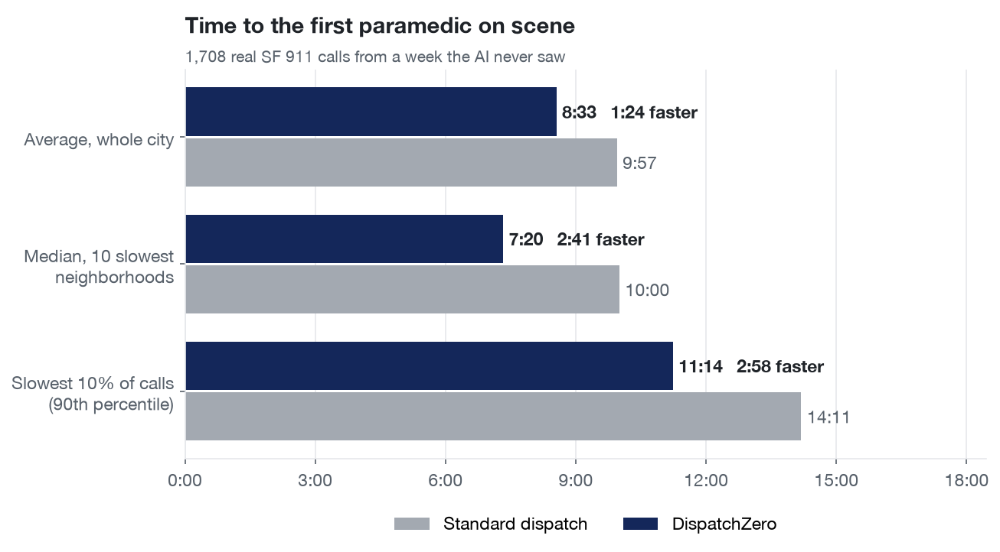
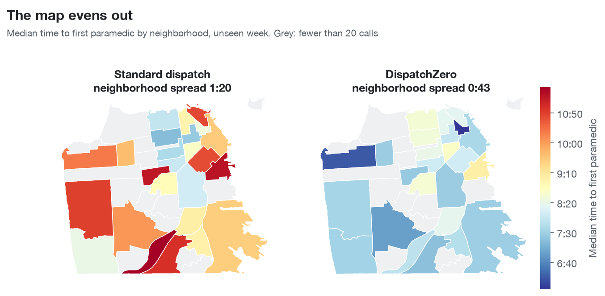
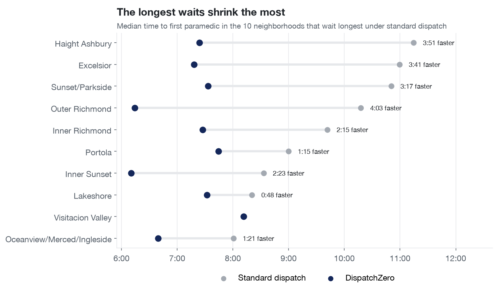
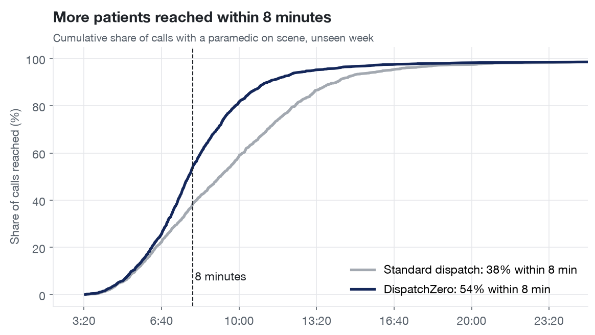
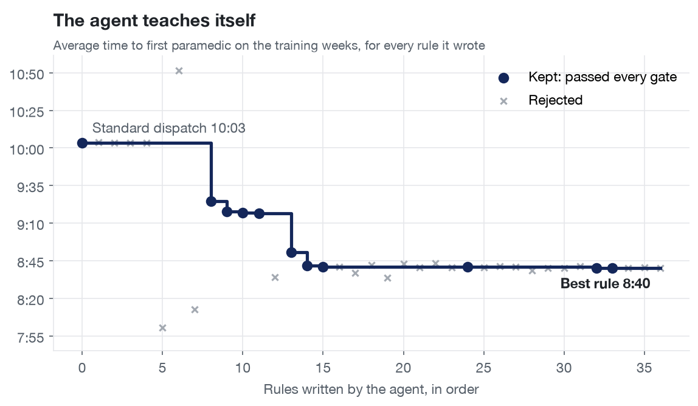
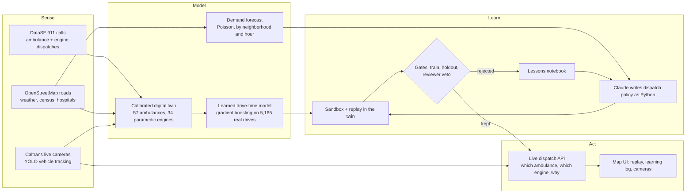
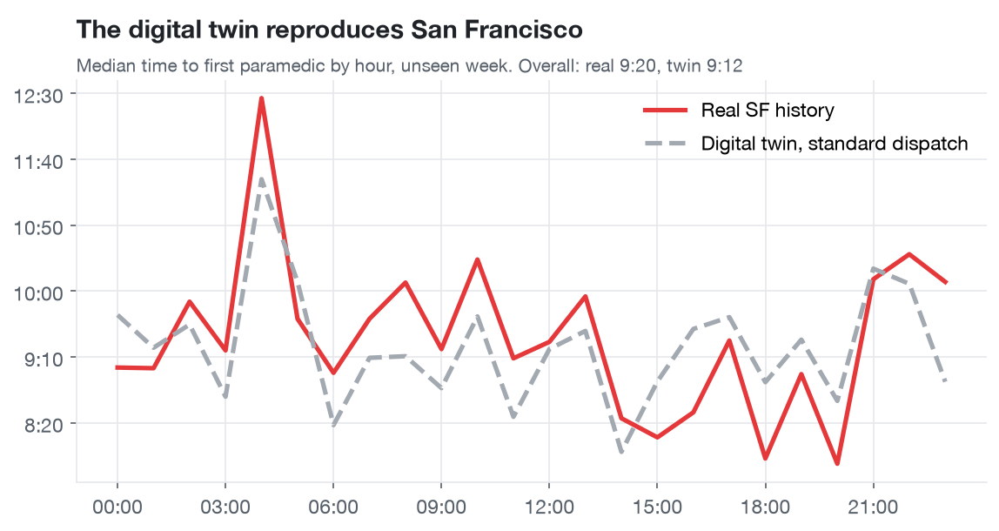

# DispatchZero

**An operating system for emergency response that teaches itself to make every neighborhood equally fast.**

DispatchZero is a self-learning dispatcher for San Francisco's ambulances and paramedic fire engines. An AI agent writes the city's dispatch playbook as code, replays real 911 history through a calibrated digital twin of the city, studies its slowest responses and rewrites itself. A new rule ships only after it wins on the weeks it studied and again on a week it has never seen. Live Caltrans traffic cameras feed the state of the road into every dispatch.

**Track:** New Operating System for the Physical World



## The problem: your neighborhood sets your wait

In a cardiac arrest, survival falls about 10% for every minute without care. In San Francisco, the 10 slowest neighborhoods wait a median of 10:00 for the first paramedic, and neighborhood medians sit 1:19 apart. DispatchZero closes that gap and makes the whole city faster at the same time.

## Results

1,708 real SF 911 medical calls from a week the AI never saw, replayed with the city's standard dispatch and with DispatchZero's learned playbook in the same calibrated digital twin. Time is measured to the first paramedic on scene.

| | Standard dispatch | DispatchZero | Change |
|---|---|---|---|
| Average, whole city | 9:57 | 8:33 | **1:24 faster** |
| Median, 10 slowest neighborhoods | 10:00 | 7:20 | **2:41 faster** (95% CI 2:10 to 3:20) |
| Median, whole city | 9:12 | 7:50 | **1:22 faster** (95% CI 1:08 to 1:36) |
| Slowest 10% of calls (90th percentile) | 14:11 | 11:14 | **2:58 faster** |
| Calls reached within 8 minutes | 38% | 54% | **+16 points** |
| Gap between neighborhoods (std. dev. of medians) | 1:19 | 0:42 | **46% more equal** |

### Faster and fairer

The neighborhoods that waited longest gain the most: Outer Richmond 4:03, Haight Ashbury 3:51, Excelsior 3:41, Sunset/Parkside 3:17.







### The agent teaches itself

39 rules written, tested and explained by the agent; 10 passed every gate and were kept. Each kept rule beat the best so far on the training weeks and beat standard dispatch on a held-out week.



## How it works



1. **Sense.** Five weeks of every SF ambulance and paramedic-engine dispatch, the full drivable road network, hourly weather, neighborhood demographics, hospital handoff times, and 33 live freeway cameras.
2. **Model.** A discrete-event digital twin of SF's emergency fleet that reproduces the city's real response times to within 1%.
3. **Learn.** Claude reads the twin's worst calls, writes a new dispatch policy in Python, and the twin scores it on weeks it studied and on a held-out week. Winners are kept, losers become lessons.
4. **Act.** The best policy dispatches any incident you click on the live map, against the current state of every unit, and explains its choice in plain English.
5. **Repeat daily.** `daily.py` fetches yesterday's calls, re-checks calibration, re-scores every kept rule and runs new learning rounds.

## Data sources

| Source | Provider | What DispatchZero uses | Volume |
|---|---|---|---|
| [Fire Department Calls for Service](https://data.sfgov.org/d/nuek-vuh3) | DataSF | Every ambulance and engine dispatch: times from call to on scene to available, location, priority, call type | 8,607 ambulance calls, 10,668 ambulance dispatches, 9,998 paramedic-engine dispatches over 5 weeks |
| [Ambulance patient offload times](https://data.sfgov.org/d/6x9q-izga) | DataSF | Hospital handoff time per hospital | 11 hospitals |
| [Neighborhood demographics, ACS 2019 to 2023](https://data.sfgov.org/d/4qbq-hvtt) | DataSF | Population and share of residents 65+ | 41 neighborhoods |
| [OpenStreetMap](https://www.openstreetmap.org) drive network | OSM via osmnx | Every drivable road with speed limits, for routing and drive times | 10,033 intersections |
| [OpenStreetMap](https://www.openstreetmap.org) hospitals | OSM | Emergency hospitals where transports end | 11 hospitals |
| [Historical weather](https://open-meteo.com/en/docs/historical-weather-api) | Open-Meteo | Hourly rain and temperature for demand forecasting | 840 hours |
| [District 4 CCTV](https://cwwp2.dot.ca.gov/data/d4/cctv/cctvStatusD04.json) | Caltrans | Live freeway video, read by YOLOv8 vehicle tracking | 33 San Francisco cameras |
| [Analysis Neighborhoods](https://data.sfgov.org/d/j2bu-swwd) | DataSF | Neighborhood boundaries for every call and the maps | 41 neighborhoods |

Built from those sources:

| Model | What it learns | Size |
|---|---|---|
| Drive-time model | Gradient boosting on real ambulance drives | 5,165 drives, error 253 s to 197 s |
| Demand forecast | Poisson regression on neighborhood, hour, weekend, heat and rain | 34,440 neighborhood-hours |
| Road speeds | Speed multiplier per neighborhood and time of day | about 200 cells |
| Engine workload | Each engine's typical runs per hour of day | 34 engines × 24 hours |

## What made this hard

**A digital twin with no GPS feed.** SF publishes no ambulance locations, so DispatchZero rebuilds the fleet from the dispatch record: posts from where calls happen, a home post for each of 57 ambulances, real shifts and busy times, queueing, relocation drives, and patients delivered to the actual hospital. 34 paramedic engines stay busy with their 9,998 real runs. The twin matches SF's real median response within 1.0% on the weeks it was fit to and 0.9% on the frozen week.



**Learned drive times.** A gradient-boosted model trained on 5,165 real ambulance drives cut drive-time error from 253 s to 197 s on a held-out week, and the twin is re-calibrated on top of it. Every call-to-post prediction is precomputed, so scoring a candidate rule stays fast.

**AI-written code running a city service, safely.** Every policy the agent writes is parsed and checked before it loads (allow-listed imports, no file access, no `eval`, no reflection), then runs in its own process under a macOS sandbox with no network and a timeout. The policy only records its decisions; the parent replays them through its own simulator, so every score comes from trusted code.

**An agent that cannot fool itself.** The agent studies three weeks, a fourth week is a pass/fail gate whose numbers it never sees, and the fifth week stays sealed until the final result. Each round writes four candidates in parallel from different angles, a second model reviews each one and can veto it, and a lessons notebook carries what worked into the next round. Every result is a paired comparison with bootstrap 95% confidence intervals.

**The agent found the lever itself.** SF's 34 paramedic engines beat the ambulance about 75% of the time when they go. The agent learned when to add one, by neighborhood, hour and each engine's own workload, with life-threatening calls counting double. Its rules read like a dispatcher's notes: *"Chinatown at hour 10 and Tenderloin and South of Market at midday show ambulances taking 800 to 1300 s while an idle engine is 200 to 450 s away."*

**Computer vision in the dispatch loop.** `cameras.py` pulls live Caltrans video, tracks vehicles with YOLOv8, and turns their count and motion into a slowdown on the matching freeway roads. Live dispatch recomputes every unit's drive time and says when a jam changed its choice: *"Cameras show US-101 : 17th Street at 3.5x normal travel time. Without the cameras this dispatcher would send M517; it sends M521 instead, about 72 s sooner."*

## Why it is a new operating system for the physical world

Emergency dispatch runs on fixed, hand-written rules. DispatchZero turns it into a closed loop: it senses the city through public data and live cameras, keeps a calibrated model of every unit, writes its own improvements, proves them on unseen data before they act, and explains every decision to the dispatcher in charge. The same loop runs for any city that publishes its 911 data.

## Reproduce

```bash
uv venv --python 3.12 .venv
uv pip install --python .venv/bin/python -r requirements.txt
.venv/bin/python backend/fetch.py
.venv/bin/python backend/sim.py --calibrate
.venv/bin/python backend/sim.py --fit-speeds
.venv/bin/python backend/sim.py --fit-eta
.venv/bin/python backend/sim.py --self-check
.venv/bin/uvicorn --app-dir backend api:app --port 8000
cd frontend && npm install && npm run dev
.venv/bin/python backend/agent.py --engines --iters 4
.venv/bin/python backend/agent.py --engines --headline
```

`fetch.py` downloads the last 5 full weeks of SF ambulance calls (weeks 1 to 3 train, week 4 holdout, week 5 frozen), ambulance posts, unit home posts, paramedic-engine dispatches, weather, neighborhood data, hospital handoff times, SF Caltrans cameras, and the OpenStreetMap road graph into `data/` (gitignored). Pass `--skip-graph` to skip the road graph. `backend/cameras.py --once` takes a live camera reading. `backend/charts.py` regenerates every chart in this README from the scored results.

## Architecture

Diagrams of every component and the full technical reference (simulator, policy contract and sandbox, learned models, agent loop, cameras, live dispatch, API) are in [ARCHITECTURE.md](ARCHITECTURE.md).
