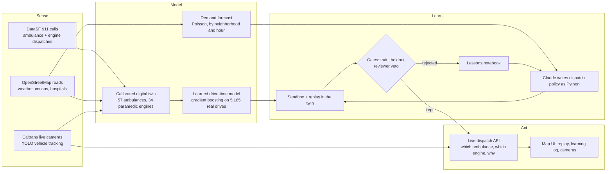

# Golden Minute

**An operating system for emergency response that teaches itself to make every neighborhood equally fast.**

Golden Minute is a self-learning dispatcher for San Francisco's ambulances and paramedic fire engines. An AI agent writes the city's dispatch playbook as code, replays real 911 history through a calibrated digital twin of the city, studies its slowest responses, and rewrites itself. A new rule ships only after it wins on weeks it studied and again on a week it has never seen. Live Caltrans traffic cameras feed what is happening on the road right now into every dispatch.

Track: **New Operating System for the Physical World.**

## The problem: your zip code sets your wait

In a cardiac arrest, survival falls about 10% for every minute without care. In San Francisco, the 10 slowest neighborhoods wait a median of 10:00 for the first paramedic, and neighborhood medians spread 1:19 apart. Golden Minute closes that gap and makes the whole city faster at the same time.

## Results

A real week of SF 911 medical calls (1,708 calls) the AI never saw, replayed with the city's standard dispatch and with Golden Minute's learned playbook, in the same calibrated simulator. Time is to the first paramedic on scene.

| | Standard dispatch | Golden Minute | Change |
|---|---|---|---|
| Average, whole city | 9:57 | 8:33 | **1:24 faster** |
| Median, 10 slowest neighborhoods | 10:00 | 7:20 | **2:41 faster** (95% CI 2:10 to 3:20) |
| Median, whole city | 9:12 | 7:50 | **1:22 faster** (95% CI 1:08 to 1:36) |
| Slowest 10% of calls (90th percentile) | 14:11 | 11:14 | **2:58 faster** |
| Calls reached within 8 minutes | 38% | 54% | **+16 points** |
| Gap between neighborhoods (std. dev. of medians) | 1:19 | 0:42 | **46% more equal** |

The neighborhoods that waited longest gain twice as much as the city as a whole, so the city gets faster and fairer at once.

## How it works



1. **Sense.** Five weeks of every SF ambulance and paramedic-engine dispatch, the full drivable road network, hourly weather, neighborhood demographics, hospital handoff times, and 33 live freeway cameras.
2. **Model.** A discrete-event digital twin of SF's emergency fleet that reproduces the city's real response times to within 1%.
3. **Learn.** Claude reads the twin's worst calls, writes a new dispatch policy in Python, and the twin scores it on weeks it studied and on a held-out week. Winners are kept, losers become lessons.
4. **Act.** The best policy dispatches any incident you click on the live map, against the current state of every unit, and explains its choice in plain English.
5. **Repeat daily.** `daily.py` fetches yesterday's calls, re-checks calibration, re-scores every kept rule and runs new learning rounds.

## What made this hard

**A digital twin with no GPS feed.** SF publishes no ambulance locations. We rebuilt the fleet from the dispatch record itself: posts from where calls happen, a home post for each of 57 ambulances, real shifts, real busy times, queueing, relocation drives, and patients delivered to the actual hospital. 34 paramedic engines stay busy with their 9,998 real fire and medical runs. The twin matches SF's real median response within 1.0% on the weeks it was fit to and 0.9% on the frozen week; first-paramedic times match 550 s vs 548 s and 557 s vs 560 s.

**Learned drive times.** A gradient-boosted model trained on 5,165 real ambulance drives (road time, distance, hour, weekday, neighborhood, post and coordinates) cut drive-time error from 253 s to 197 s on a held-out week. It replaced the formula only after winning that test, and the twin is re-calibrated on top of it. The full call-by-post prediction matrix is precomputed, so scoring a candidate stays fast.

**Letting an AI write code that runs a city service, safely.** Every AI-written policy is parsed and checked before it loads (allow-listed imports and functions only, no file access, no `eval`, no reflection), then runs in its own process under a macOS sandbox with no network and a timeout. The policy only records its decisions; the parent replays them through its own simulator, so every score comes from trusted code.

**An agent that cannot fool itself.** Three time splits: the agent learns from three weeks, a fourth week is a pass/fail gate it never sees the numbers of, and the fifth week is frozen until the final headline. Each round writes four candidates in parallel from different angles (which engine to send, where ambulances wait, which ambulance to send, all combined). A second model reviews each candidate and can veto it, and a lessons notebook carries what worked and what failed into the next round. 39 rules written and tested, 10 kept. Every result is a paired comparison with bootstrap 95% confidence intervals.

**The agent found the lever itself.** SF sends a fire engine to 43% of medical calls, yet its 34 paramedic engines usually beat the ambulance when they go. The agent learned when to add an engine, neighborhood by neighborhood, hour by hour, weighted by each engine's own workload, with life-threatening calls counting double. Its kept rules read like a dispatcher's notes, for example: *"Chinatown at hour 10 and Tenderloin and South of Market at midday show ambulances taking 800 to 1300 s while an idle engine is 200 to 450 s away."*

**Computer vision in the dispatch loop.** `cameras.py` pulls live Caltrans HLS video, tracks vehicles across each clip with YOLOv8, and turns their count and motion into a slowdown factor. That factor slows the matching freeway segments in the road graph, every unit's drive time is recomputed, and live dispatch says when a jam changed its choice: *"Cameras show US-101 : 17th Street at 3.5x normal travel time. Without the cameras this dispatcher would send M517; it sends M521 instead, about 72 s sooner."*

**Nine live and historical data sources fused into one model.** 8,607 ambulance calls, 10,668 ambulance dispatches, 9,998 paramedic-engine dispatches, a 10,033-intersection road graph, 840 hours of weather, 41 neighborhoods of census data, 11 hospitals' handoff times, a 34,440-cell demand forecast, and 33 live cameras.

## Why it is a new operating system for the physical world

Emergency dispatch runs on fixed, hand-written rules. Golden Minute turns it into a closed loop: it senses the city through public data and cameras, keeps a calibrated model of every unit, writes its own improvements, proves them on unseen data before they act, and explains every decision to the human in charge. The same loop works for any city that publishes its 911 data.

## Reproduce

```bash
uv venv --python 3.12 .venv
uv pip install --python .venv/bin/python -r requirements.txt
.venv/bin/python backend/fetch.py
.venv/bin/python backend/incidents.py --history
.venv/bin/python backend/incidents.py --reports
.venv/bin/python backend/incidents.py --crashes
.venv/bin/python backend/sim.py --calibrate
.venv/bin/python backend/sim.py --fit-speeds
.venv/bin/python backend/sim.py --fit-eta
.venv/bin/python backend/sim.py --self-check
.venv/bin/uvicorn --app-dir backend api:app --port 8000
cd frontend && npm install && npm run dev
.venv/bin/python backend/agent.py --engines --iters 4
.venv/bin/python backend/agent.py --engines --headline
```

`fetch.py` downloads the last 5 full weeks of SF ambulance calls (weeks 1 to 3 train, week 4 holdout, week 5 frozen), ambulance posts, unit home posts, paramedic-engine dispatches, weather, neighborhood data, hospital handoff times, SF Caltrans cameras, and the OpenStreetMap road graph into `data/` (gitignored). Pass `--skip-graph` to skip the road graph. `backend/cameras.py --once` takes a live camera reading. `incidents.py` adds SFPD calls, SFPD incident reports, CHP freeway incidents and injury crashes for the map (run it with `--loop` for live SFPD and CHP); see Incident layers in `ARCHITECTURE.md`.

## Architecture

The full technical reference (file layout, policy contract, simulator rules, calibration, learned models, cameras, engines, agent loop, forecast and API) is in [ARCHITECTURE.md](ARCHITECTURE.md).
