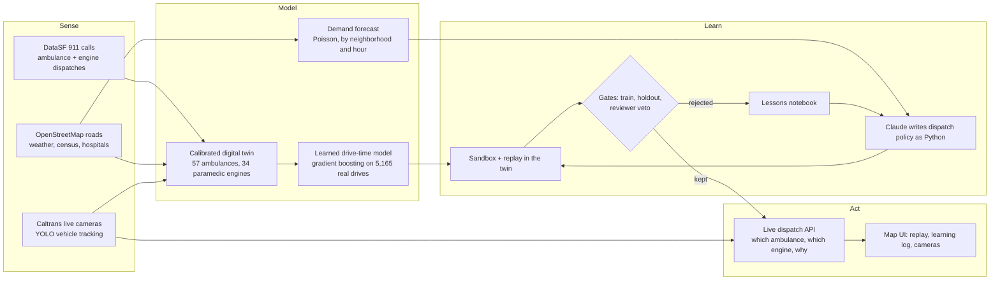

# Golden Minute

**An operating system for emergency response that teaches itself to make every neighborhood equally fast.**

Golden Minute is a self-learning dispatcher for San Francisco's ambulances and paramedic fire engines. An AI agent writes the city's dispatch playbook as code, replays real 911 history through a calibrated digital twin of the city, studies its slowest responses, and rewrites itself. A new rule ships only after it wins on weeks it studied and again on a week it has never seen. Live Caltrans traffic cameras feed what is happening on the road right now into every dispatch.

Track: **New Operating System for the Physical World.**

## The problem: your zip code sets your wait

In a cardiac arrest, survival falls about 10% for every minute without care. In San Francisco, the 10 slowest neighborhoods wait a median of 10:00 for the first paramedic, and neighborhood medians spread 1:19 apart. Golden Minute closes that gap and makes the whole city faster at the same time.

## Results

A real week of SF 911 medical calls (1,708 calls) the AI never saw, replayed with the city's standard dispatch and with Golden Minute's learned playbook, in the same calibrated simulator. Time is to the first paramedic on scene.

| | Standard dispatch | Golden Minute | Change |
|---|---|---|---|
| Average, whole city | 9:57 | 8:33 | **1:24 faster** |
| Median, 10 slowest neighborhoods | 10:00 | 7:20 | **2:41 faster** (95% CI 2:10 to 3:20) |
| Median, whole city | 9:12 | 7:50 | **1:22 faster** (95% CI 1:08 to 1:36) |
| Slowest 10% of calls (90th percentile) | 14:11 | 11:14 | **2:58 faster** |
| Calls reached within 8 minutes | 38% | 54% | **+16 points** |
| Gap between neighborhoods (std. dev. of medians) | 1:19 | 0:42 | **46% more equal** |

The neighborhoods that waited longest gain twice as much as the city as a whole, so the city gets faster and fairer at once.

## How it works



1. **Sense.** Five weeks of every SF ambulance and paramedic-engine dispatch, the full drivable road network, hourly weather, neighborhood demographics, hospital handoff times, and 33 live freeway cameras.
2. **Model.** A discrete-event digital twin of SF's emergency fleet that reproduces the city's real response times to within 1%.
3. **Learn.** Claude reads the twin's worst calls, writes a new dispatch policy in Python, and the twin scores it on weeks it studied and on a held-out week. Winners are kept, losers become lessons.
4. **Act.** The best policy dispatches any incident you click on the live map, against the current state of every unit, and explains its choice in plain English.
5. **Repeat daily.** `daily.py` fetches yesterday's calls, re-checks calibration, re-scores every kept rule and runs new learning rounds.

## What made this hard

**A digital twin with no GPS feed.** SF publishes no ambulance locations. We rebuilt the fleet from the dispatch record itself: posts from where calls happen, a home post for each of 57 ambulances, real shifts, real busy times, queueing, relocation drives, and patients delivered to the actual hospital. 34 paramedic engines stay busy with their 9,998 real fire and medical runs. The twin matches SF's real median response within 1.0% on the weeks it was fit to and 0.9% on the frozen week; first-paramedic times match 550 s vs 548 s and 557 s vs 560 s.

**Learned drive times.** A gradient-boosted model trained on 5,165 real ambulance drives (road time, distance, hour, weekday, neighborhood, post and coordinates) cut drive-time error from 253 s to 197 s on a held-out week. It replaced the formula only after winning that test, and the twin is re-calibrated on top of it. The full call-by-post prediction matrix is precomputed, so scoring a candidate stays fast.

**Letting an AI write code that runs a city service, safely.** Every AI-written policy is parsed and checked before it loads (allow-listed imports and functions only, no file access, no `eval`, no reflection), then runs in its own process under a macOS sandbox with no network and a timeout. The policy only records its decisions; the parent replays them through its own simulator, so every score comes from trusted code.

**An agent that cannot fool itself.** Three time splits: the agent learns from three weeks, a fourth week is a pass/fail gate it never sees the numbers of, and the fifth week is frozen until the final headline. Each round writes four candidates in parallel from different angles (which engine to send, where ambulances wait, which ambulance to send, all combined). A second model reviews each candidate and can veto it, and a lessons notebook carries what worked and what failed into the next round. 39 rules written and tested, 10 kept. Every result is a paired comparison with bootstrap 95% confidence intervals.

**The agent found the lever itself.** SF sends a fire engine to 43% of medical calls, yet its 34 paramedic engines usually beat the ambulance when they go. The agent learned when to add an engine, neighborhood by neighborhood, hour by hour, weighted by each engine's own workload, with life-threatening calls counting double. Its kept rules read like a dispatcher's notes, for example: *"Chinatown at hour 10 and Tenderloin and South of Market at midday show ambulances taking 800 to 1300 s while an idle engine is 200 to 450 s away."*

**Computer vision in the dispatch loop.** `cameras.py` pulls live Caltrans HLS video, tracks vehicles across each clip with YOLOv8, and turns their count and motion into a slowdown factor. That factor slows the matching freeway segments in the road graph, every unit's drive time is recomputed, and live dispatch says when a jam changed its choice: *"Cameras show US-101 : 17th Street at 3.5x normal travel time. Without the cameras this dispatcher would send M517; it sends M521 instead, about 72 s sooner."*

**Nine live and historical data sources fused into one model.** 8,607 ambulance calls, 10,668 ambulance dispatches, 9,998 paramedic-engine dispatches, a 10,033-intersection road graph, 840 hours of weather, 41 neighborhoods of census data, 11 hospitals' handoff times, a 34,440-cell demand forecast, and 33 live cameras.

## Why it is a new operating system for the physical world

Emergency dispatch runs on fixed, hand-written rules. Golden Minute turns it into a closed loop: it senses the city through public data and cameras, keeps a calibrated model of every unit, writes its own improvements, proves them on unseen data before they act, and explains every decision to the human in charge. The same loop works for any city that publishes its 911 data.

## Reproduce

```bash
uv venv --python 3.12 .venv
uv pip install --python .venv/bin/python -r requirements.txt
.venv/bin/python backend/fetch.py
.venv/bin/python backend/sim.py --calibrate
.venv/bin/python backend/sim.py --fit-speeds
.venv/bin/python backend/sim.py --fit-eta
.venv/bin/python backend/sim.py --self-check
.venv/bin/uvicorn --app-dir backend api:app --port 8000
cd frontend && npm install && npm run dev
.venv/bin/python backend/agent.py --engines --iters 4
.venv/bin/python backend/agent.py --engines --headline
```

`fetch.py` downloads the last 5 full weeks of SF ambulance calls (weeks 1 to 3 train, week 4 holdout, week 5 frozen), ambulance posts, unit home posts, paramedic-engine dispatches, weather, neighborhood data, hospital handoff times, SF Caltrans cameras, and the OpenStreetMap road graph into `data/` (gitignored). Pass `--skip-graph` to skip the road graph. `backend/cameras.py --once` takes a live camera reading.

# Technical reference

## Layout

| Path | Owner | What |
|---|---|---|
| `backend/contracts.py` | All | Frozen shapes: `Call`, `IdleUnit`, `CallResult`, `Summary`, `Version`, `CameraReading`, policy signatures |
| `backend/fetch.py` | A | Data download |
| `backend/sim.py` | A | `replay(calls, policy, slowdowns, version, split) -> (results, summary)`. Replays real calls over the OSM road graph with unit shifts, background load, queueing and relocation time. CLI: `--policy NAME_OR_PATH --split train\|holdout\|fit\|frozen [--compare baseline] [--out FILE]`, `--calibrate`, `--fit-speeds`, `--worst N`, `--jam-test CAMERA_ID [--slowdown F]`, `--traffic [PROFILE_JSON]`, `--traffic-report`, `--offload-cap MINUTES`, `--dispatch-at-entry`, `--self-check`, `--fixtures` |
| `backend/policies/baseline.py` | A | Reference policy: each unit at its home post, closest idle unit sent |
| `backend/agent.py` | C | Improvement loop: `--iters N [--model sonnet] [--traffic]`, `--headline` |
| `backend/api.py` | C | FastAPI: `uvicorn --app-dir backend api:app --port 8000` |
| `backend/dispatch.py` | B | Live dispatch of one incident: replays the frozen week to that moment, then compares baseline and the best engine-mode version (ambulance, engine, hospital, routes). `/dispatch?lat=&lon=&t=`; CLI `dispatch.py LAT LON T`. Set `GOOGLE_MAPS_API_KEY` to re-time the closest candidates with live traffic. Without it (or when a Google request fails), the latest `data/camera_readings.json`, if under 30 minutes old, slows the freeways it covers: every idle unit's time gets the jam's extra seconds, candidates are ranked on those times, the ambulance route avoids the jam (engine and hospital routes do not), and `traffic_reason` says when a slowed camera on the original pick's route changed the pick (`traffic: google\|cameras\|osm`, `cameras_ts`) |
| `backend/forecast.py` | C | Poisson demand forecast per neighborhood and hour |
| `backend/daily.py` | C | Daily loop: fetch, calibrate if needed, re-score, learn, publish |
| `backend/cameras.py` | B | Caltrans → YOLO → `CameraReading`; latest in `data/camera_readings.json`, history appended to `data/camera_log.jsonl` (timestamps in San Francisco time; `--clip` replays are marked `"source": "clip"` and never logged) |
| `fixtures/` | B, C | Sample `results.json`, `summary.json`, `versions.jsonl`, `cameras.json`, `posts.json` in contract shape. Regenerate with `python backend/sim.py --fixtures` |
| `frontend/` | B | Vite + React + MapLibre + deck.gl: replay map with a 3D view, learning log, call flow, live dispatch, live camera video |
| `PITCH.md` | C | 3-minute pitch script with the real frozen-week numbers, slide outline and judge Q&A |

## Policy contract

A policy is a Python file in `backend/policies/` with two functions:

```python
def post_plan(hour: int, units: list[str]) -> dict[str, int]
def choose_unit(call: Call, idle: list[IdleUnit], eta) -> str
```

`post_plan` is called at every hour boundary with the units on shift at that moment; units it leaves out keep their current post. `eta(unit, call)` returns drive seconds from the unit's current position to the call.

Injected globals:
- `HOME`: unit to home post (the baseline layout, see below)
- `POSTS`: list of `{post, station_area, lat, lon}`
- `DEMAND`: `{bucket: {post: calls}}` from the training weeks, each call counted at its nearest post
- `POST_DRIVE`: road drive seconds between posts, `POST_DRIVE[from][to]`
- `BUCKET_OF`: hour to time bucket (`night`, `morning_rush`, `midday`, `evening_rush`, `evening`)
- `WEATHER`: `"2026-09-07T14"` (call `t[:13]`) to `{rain_mm, temp_c}`, hourly from the Open-Meteo archive
- `NBHD`: neighborhood to `{population, pct_65_plus}`, ACS 2019 to 2023 via DataSF `4qbq-hvtt`
- `FORECAST`: `"Neighborhood|2026-09-07T14"` to expected calls that hour (`backend/forecast.py`, fit on the training weeks only), empty until `data/forecast.json` exists
- `TRAFFIC`: with `sim.py --traffic` only, otherwise `{}`. Time bucket to the freeway cameras slowed in it, `[{camera_id, name, route, lat, lon, slowdown, n}]`: the median of at least 3 logged camera readings in that bucket. `eta` and the simulator's dispatch, return, move and engine drive times already include it.
- `COVERAGE(units, call)`: lookahead. Expected seconds to reach this hour's forecast calls (FORECAST-weighted over neighborhoods) if only `units` (dicts with `post`) stay free. Compare `COVERAGE(idle, call)` with `COVERAGE(idle minus a candidate, call)` to see what sending that unit costs the next caller.

Rules the simulator enforces:
- Policies only see dispatcher-visible call fields: an opaque per-run `call_id`, `t`, `lat`, `lon`, `hour`, `nbhd`, `station_area`, `priority`, `life_threatening` (call type group is Potentially Life-Threatening, 62% of calls).
- Source is checked before loading: imports limited to `math`, `statistics`, `collections`, `itertools`, `functools`, `heapq`, `bisect`, `random`, and a module may only be used as `module.function` from a fixed export list (no `statistics.sys`, no submodules, no passing modules around). No attribute assignment, no reassigning anything imported, no `class` definitions, no names starting with `__`, no file access, `eval`/`exec`, `getattr`, `str.format` (use f-strings), underscore attributes, or frame attributes like `gi_frame`. Violations raise `PolicyRejected`.
- Every policy except `policies/baseline.py` runs in a separate process with a 90 s timeout. On macOS it is wrapped in `sandbox-exec`: no network, no starting other programs, writes only to its own temp dir, and file contents readable only from Python, `backend/` and `data/`. Without `sandbox-exec` it refuses to run unless `GM_UNSANDBOXED=1` is set. That process only records the policy's decisions (each hour's plan, each `choose_unit` and `send_engine` answer). The parent never imports the policy: it replays those decisions through its own `simulate`, so every result, stat, `--worst` row and `goal` comes from simulator code. `random` is seeded before the policy loads and at the start of every simulation, so runs are repeatable.
- `choose_unit` must return an idle unit's id. Anything else, or an exception, falls back to the closest idle unit and is counted in `stats`.
- Moving a unit to a new post takes its drive time between posts, starting at the hour boundary. It stays available while moving and is dispatched from its old post until it arrives.
- After each call the unit becomes free where it actually finished: at the nearest emergency hospital (`data/hospitals.json`, from OpenStreetMap) if the call record shows a transport, otherwise at the scene. It is available right away and is dispatched from the post nearest that spot until it has driven back to its own post.

## Baseline

`units.json` spreads the 57 units across posts in proportion to training-week call volume by station area (largest remainder). The baseline policy keeps every unit at that home post and sends the closest idle unit. `unit_areas.json` keeps each unit's most frequent station area, used only to fit road speeds.

## The goal

The agent's job is to make SF's 10 slowest neighborhoods faster without slowing everyone else. `sim.py --calibrate` picks them from the baseline on the training weeks and saves `data/slow_nbhds.json`. Every summary includes `slow_median_s` and `slow_n`. `--compare baseline` returns:

- `slow_nbhds`: paired median difference and 95% CI for calls in those neighborhoods
- `everyone`: the same for all calls
- `passes`: true when the slow-neighborhood CI is entirely below zero and the citywide median is at most 5 s slower (`OVERALL_TOLERANCE_S`)

## Splits and reporting

- `train` (weeks 1 to 3): the agent diagnoses from these.
- `holdout` (week 4): the agent's promotion gate.
- `frozen` (week 5): touched only for the final headline, reported with `--compare baseline` (paired bootstrap 95% CI). Gains are reported as paired differences with bootstrap 95% confidence intervals.

## Calibration

Simulated drive = OSM road time × learned neighborhood multiplier + one offset per time bucket. The offsets (about 290 to 340s) are fit so the baseline's median simulated drive matches SF's median real drive on weeks 1 to 4. They stand for everything the road graph misses, mostly units not sitting exactly at their post. Because the offset is additive, seconds saved by better positioning count 1:1 and are not amplified.

Current fit: baseline sim median 657s vs actual 663s on weeks 1 to 4 (−1.0%); frozen week 664s vs 658s (+0.9%).

## Learned road speeds

`--fit-speeds` learns one multiplier per (destination neighborhood × time bucket), about 200 cells, in the additive model: `real drive ≈ route time from the unit's usual post × multiplier + bucket offset`, fit on weeks 1 to 3. Cells with few calls shrink toward 1 (weight 30 calls), and multipliers are capped to 0.5 to 2×. They are adopted only if they lower median drive-time error on the holdout week, then calibration is re-run. Current result: holdout error 206s → 196s (adopted). Fastest: Outer Richmond, Bernal Heights, Sunset (about 0.72×); slowest: Tenderloin (capped at 2×).

`data/speeds.json` holds `adopted`, the error `report`, `rel` (`"Neighborhood|bucket": multiplier`), and `nbhd_centers` (`"Neighborhood": [lat, lon]`) for the UI heatmap.

## Learned drive times

`sim.py --fit-eta` trains a gradient-boosted model (scikit-learn, absolute-error loss) on the training weeks' real drives, from each unit's usual post to the call. Inputs are road travel time, straight-line distance, hour, weekday, neighborhood, post and both endpoints' coordinates. It is adopted only if it lowers median drive-time error on the holdout week: current result 253 s → 197 s, with the median prediction 467 s vs 470 s actual (the old formula gave 604 s). When adopted (`data/eta.json`, `data/eta_model.pkl`), ambulance drive times come from the model plus a per-bucket shift that `--calibrate` fits. Baseline sim vs actual median: −2.9% on fit, −0.8% on frozen. Engines keep the road-time formula.

## Cameras in the simulator

- `edge_slowdowns(readings, roads)` turns `CameraReading`s into `{edge_index: factor}`: road edges within 600 m of the camera whose OSM `ref` matches the camera's route (`US-101` → `US 101`, `SR-1` → `CA 1`) are slowed by the camera's `slowdown`. Readings with `slowdown <= 1` change nothing.
- `World.load(slowdowns=...)` rebuilds travel times with those slowdowns.
- `Roads.path(src_node, dst_node, slowdowns)` returns `(seconds, [[lat, lon], ...])` for drawing a route on the map.
- `--jam-test CAMERA_ID` measures the direct effect of a jam on the holdout week: calls whose best route crosses the jam, calls that should be sent from a different post, and seconds saved by switching versus dispatching blind.

- `--traffic` turns `data/camera_log.jsonl` into a typical slowdown per camera and time bucket (`traffic_profile`, median of at least 3 readings, only slowdowns above 1) and gives each bucket its own drive times, used for dispatch, `eta`, returns, moves and engines. With learned drive times the jam's extra seconds are added on top of the learned time. Demand, `POST_DRIVE`, `COVERAGE`, `--worst`/trace context and where a unit ends up after a call stay on normal roads. `--traffic PROFILE_JSON` uses a saved `--traffic-report` instead of the live log, and a sandboxed policy's child process gets the parent's exact profile. `--traffic` is refused with `--calibrate`, `--fit-speeds`, `--fit-eta`, `--fixtures` and `--jam-test`, so calibration files never see it. Off by default, so scores without it are unchanged. `--traffic-report` prints the profile.
- `agent.py --traffic` freezes the profile into `runs/traffic_profile.json` at start and scores every candidate and baseline with it, lists the slowest cameras per bucket in the prompt, and keeps a separate experiment: `*_traffic` versions, headline and lessons files, rows marked `"traffic": true`, and no fixture snapshot.

## Hospital handoff what-if

A transported patient's ambulance spends a median 43 minutes between arriving at the hospital and being available again (`hospital_s` in `calls.parquet`; 97% of transports take over 20 minutes). `sim.py --offload-cap MINUTES --split holdout [--policy NAME]` replays the same calls with that time capped and compares:

| Cap | Everyone (median) | Average | Slow neighborhoods | 90th percentile |
|---|---|---|---|---|
| 30 min | −10 s (CI −16 to −5) | −16 s | −31 s | −25 s |
| 20 min | −20 s (CI −28 to −15) | −26 s | −34 s | −43 s |

## Dispatch-at-entry what-if

The 148 s median from call received to dispatch splits into received → entry (call-taking, median 98 s) and entry → dispatch (median 37 s). `sim.py --dispatch-at-entry --split holdout` replays the calls with each unit dispatched at entry instead, for example by an AI pre-alert as soon as the call is entered:

| Scenario | Everyone (median) | Average | Slow neighborhoods |
|---|---|---|---|
| Dispatch at entry | −62 s (CI −69 to −55) | −90 s | −52 s |
| Dispatch at entry + 20-min hospital cap | −80 s (CI −89 to −73) | −116 s | −78 s |

## Paramedic engines

SF sends a fire engine to only 43% of ambulance calls, and 34 of its engines carry a paramedic. When one goes, it beats the ambulance about 75% of the time, by a median of about 2.7 minutes. `sim.py --engines` adds those engines: each waits at its own station, stays busy with its real fire and other calls (`data/engine_dispatches.parquet`), and the score becomes the time to the first paramedic on scene, by engine or by ambulance. It is calibrated against history without replay tuning: engine offsets come from fit weeks only. The simulated first-paramedic median is 550 s vs a real 548 s on fit and 557 s vs 560 s on frozen.

A policy can add:

```python
def send_engine(call: Call, engines: list[IdleUnit], eta, ambulance_s: float) -> str | None
```

`engines` are idle paramedic engines (`kind: "engine"`, so `eta` uses engine timing), `ambulance_s` is the chosen ambulance's time from dispatch to scene, and `ENGINES` (engine to station post) and `ENGINE_LOAD` (`"E01|15"`: that engine's other dispatches per day in that hour, from the fit weeks) are injected. Without `send_engine`, the simulator sends the nearest idle engine exactly when history did. Summaries also report `lt_mean_s` (life-threatening calls only) `weighted_mean_s` (life-threatening calls count double) and `nbhd_spread_s` (standard deviation of neighborhood medians, neighborhoods with 20+ calls; lower is a more even city).

Frozen week, first paramedic on scene, paired against the baseline:

| Policy | Everyone (median) | Slow neighborhoods | Under 8 min |
|---|---|---|---|
| Baseline (history's engine use) | 557 s | | 37% |
| `reference_engine_3min`: send if 3+ min ahead of the ambulance | −75 s (CI −90 to −63) | −123 s (CI −147 to −88) | 49% |
| `reference_engine_load`: send if ahead by 30 s plus 10 min per daily call the engine usually gets that hour | −71 s (CI −85 to −60) | −137 s (CI −160 to −105) | 48% |
| `reference_engine`: send if ahead of the ambulance | −127 s (CI −140 to −116) | −148 s (CI −169 to −115) | 66% |

## Agent context

`sim.py --policy NAME --split train --worst 50 --out FILE` returns the 50 calls with the most controllable time (queue wait + drive), each with the closest post, its drive time, which units were based there and whether they were idle, busy or off duty, plus `avoidable_s`, and aggregates: worst calls by neighborhood and bucket, and the top (neighborhood, bucket) cells by total avoidable seconds.

## Agent loop

`agent.py --iters N [--candidates K] [--engines]` runs N rounds. Each round writes K candidates in parallel (default 4), each prompted from a different angle (which engine to send, where ambulances wait using `FORECAST`, which ambulance to send, all three combined). Each candidate gets its own name and row. The best one that passes both gates is accepted (lowest training `weighted_mean_s` in engine mode, lowest slow-neighborhood median otherwise), and the other passers are rejected with "beaten by NAME this round". Each candidate:

1. Takes the newest accepted version in `runs/versions.jsonl` as the current best (`baseline` on the first run).
2. Asks Claude through the `claude` CLI (`--model`, default `sonnet`, no tools). The prompt includes the policy contract from this README, the current best's code, its training summary, the `--worst 50` context, the last 5 attempts, and the closest rejected candidate's code. Holdout numbers never go into the prompt; a holdout failure shows up only as "failed the holdout gate".
3. Writes the reply to `backend/policies/vNNN.py` and scores it with `sim.py` in a subprocess (120 s timeout). A crash, timeout, or `PolicyRejected` rejects the candidate.
4. Gate 1, train: the slow-neighborhood median must be below the current best's and citywide at most 5 s slower than baseline. Gate 2, holdout: `--compare baseline` must return `passes`.
5. Appends `{version, parent, diagnosis, train_median, frozen_median, accepted, reason, ...}` to `runs/versions.jsonl`. `frozen_median` is filled only for accepted versions and is never shown to the agent.

`agent.py --headline` scores the newest accepted version once on the frozen week against baseline and writes `runs/headline.json`.

In engine mode the objective is `weighted_mean_s` (life-threatening calls count double): a candidate must beat the current best's on training and baseline's on holdout. The prompt shows `lt_mean_s`, and rows record `train_weighted_mean` and `holdout_lt_mean_diff`.

## Demand forecast

`forecast.py` fits a Poisson regression of hourly calls per neighborhood on the training weeks only: a neighborhood effect, hour of day, weekend, heat (degrees above 25 C) and rain (more than 0.1 mm), from `data/weather.json`. It writes `data/forecast.json` with `"<nbhd>|<YYYY-MM-DDTHH>": expected calls` for every neighborhood and hour, plus `_report`: holdout deviance and MAE against a train average per neighborhood and hour of day, and the fitted effects. The 65+ effect comes from regressing the neighborhood effects on log population and `pct_65_plus` (`data/neighborhoods.json`). `--self-check` recovers known effects from synthetic data.

Current result: holdout deviance 4,135 vs 5,504 for the naive average. Rain ×1.24, heat ×1.03 per degree above 25 C.

## API

| Route | Returns |
|---|---|
| `GET /versions` | `runs/versions.jsonl` as a list, or the fixture |
| `GET /headline` | `runs/headline.json` |
| `GET /summary/{version}?split=frozen` | Summary for `baseline` or `vNNN` on `train`, `holdout` or `frozen` |
| `GET /results/{version}?split=frozen` | Per-call results for the replay |
| `GET /policy/{version}` | Policy source |
| `GET /cameras` | `data/camera_readings.json`, or the fixture |
| `GET /posts`, `/slow`, `/speeds` | `data/` files |

Results are cached in `runs/results/{version}_{split}.json`. Delete that folder after any change to default scoring. The Vite dev server proxies `/api` to port 8000.
